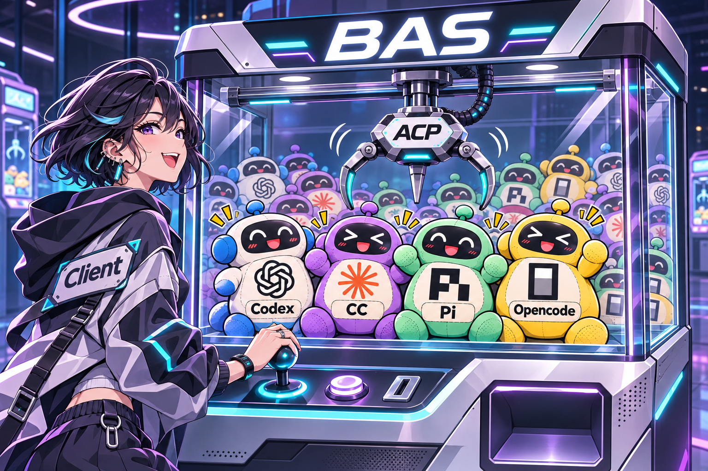

# BAS — Basic Agent Service

BAS 是一个 Agent 服务：通过 ACP 接入不同的 coding harness，统一管理工作区、会话、执行和历史，供 CLI、桌面应用等客户端使用。

客户端连接 BAS，BAS 再连接 Agent。会话和已受理的执行由 BAS 持有，客户端断线后仍可继续执行，重新连接后可读取历史、接收更新和处理交互请求。

项目处于开发阶段，接口与配置仍在调整。

## 仓库内容

- `bin/bas`：服务端，管理 Agent、会话、历史和权限交互。
- `bin/bast`：命令行客户端。
- `bin/bas-mobile`：[Rust / NSH 手机客户端](bin/bas-mobile/README.md)，以 Android 为主。
- `bin/acp-test-agent`：无模型的 ACP 协议演示程序。
- `crates/protocol`：公共协议、数据类型和传输基础。
- `crates/client`：客户端库。
- `crates/server`：ACP 服务端网关。
- `crates/config`：配置读取与持久化。

`bast → client → protocol`；`bas → server / config / protocol`。公共库不依赖二进制包，演示 Agent 直接使用 ACP SDK。

## 本地开发

```sh
nix develop
cargo build
cargo run -p bas
```

另开终端运行 `cargo run -p bast -- agents` 查看已配置的 Agent。默认通过本地 IPC 连接；外部 Agent 的安装与配置见[安装说明](docs/install.md)。

手机界面在 Linux 上使用 `make dev-mobile` 本地预览，保存 Rust 文件后自动编译并重启；`make test-mobile` 运行无窗口的 Android 会话测试。环境与真机验收步骤见[手机客户端开发说明](bin/bas-mobile/README.md)。

[架构图](docs/server-architecture.html) · [RPC 接口](docs/rpc.md) · [测试说明](docs/testing.md)
